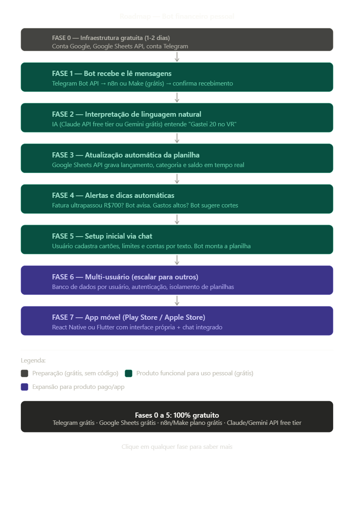

# 💰 FinBot — Assistente Financeiro Pessoal via Telegram

Automatize sua vida financeira enviando mensagens de texto. O FinBot interpreta linguagem natural, atualiza sua planilha no Google Sheets e envia alertas inteligentes.

## Como funciona

```
Você: "Gastei 20 reais no VR"
Bot:  ✅ Lançado! Saldo VR: R$ 230,00 restantes (até dia 27)
```

```
Você: "Compra no crédito Nubank de 170 reais à vista"
Bot:  ✅ Registrado! Fatura Nubank: R$ 420,00 / R$ 700,00 (60%)
```

```
Você: "Recebi 140 reais do freela"
Bot:  ✅ Receita registrada! Saldo conta: R$ 1.340,00
```

## Stack (100% gratuita para uso pessoal)

| Componente | Ferramenta | Custo |
|---|---|---|
| Chat | Telegram Bot API | Grátis |
| Automação | n8n (self-hosted) | Grátis |
| IA / NLP | Google Gemini API | Grátis (free tier) |
| Planilha | Google Sheets API | Grátis |
| Hospedagem | Railway / Render | Grátis (free tier) |

## Roadmap

- [x] Fase 0 — Estrutura do repositório
- [ ] Fase 1 — Bot Telegram recebe e responde mensagens
- [ ] Fase 2 — IA interpreta linguagem natural financeira
- [ ] Fase 3 — Atualização automática do Google Sheets
- [ ] Fase 4 — Alertas e dicas automáticas
- [ ] Fase 5 — Setup inicial via chat (cadastro de contas e cartões)
- [ ] Fase 6 — Multi-usuário
- [ ] Fase 7 — App móvel (Play Store / Apple Store)

## Início rápido

```bash
# Clone o repositório
git clone https://github.com/seu-usuario/finbot.git
cd finbot

# Instale dependências
pip install -r requirements.txt

# Configure variáveis de ambiente
cp .env.example .env
# Edite o .env com seus tokens

# Rode localmente
python src/bot/main.py
```

## Estrutura do projeto

```
finbot/
├── src/
│   ├── bot/          # Lógica do bot Telegram
│   ├── sheets/       # Integração Google Sheets
│   ├── ai/           # Interpretação de linguagem natural
│   └── alerts/       # Sistema de alertas
├── docs/             # Documentação detalhada
├── tests/            # Testes automatizados
├── .env.example      # Variáveis de ambiente necessárias
└── requirements.txt  # Dependências Python
```

## Contribuindo

Projeto pessoal em construção. Em breve aberto para colaboradores.

---

Feito com Python · Telegram · Google Sheets · Gemini AI


