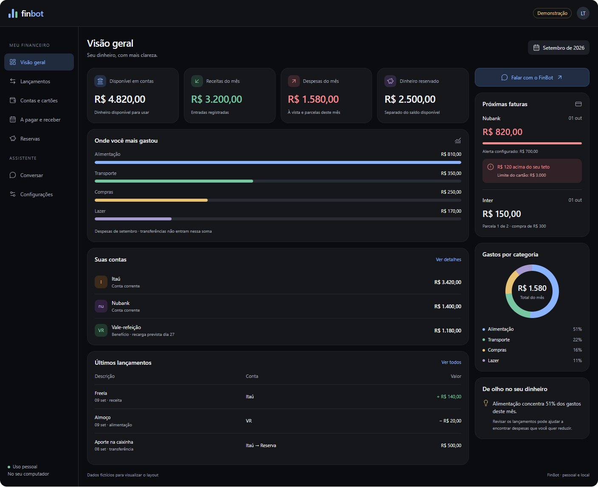
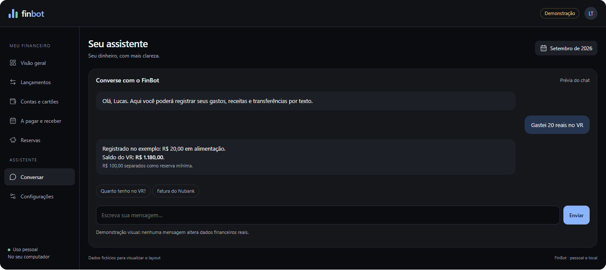

# UX do FinBot

Histórico visual do aplicativo pessoal para uso no computador. Os arquivos desta pasta permitem comparar referência, proposta e futura implementação com o [escopo](../docs/superpowers/specs/2026-09-09-finbot-design.md).

## Versão atual: v01, 09/09/2026

Estado: proposta visual, ainda sem aprovação final do desenho e sem implementação React. Os valores são fictícios e não representam dados pessoais nem o cenário de testes financeiros da especificação.

| Arquivo | Finalidade |
| --- | --- |
| [Anexo original](referencias/2026-09-09-painel-original.png) | Referência enviada na conversa, preservada sem alteração |
| [Referência anterior do repositório](referencias/2026-09-09-referencia-repositorio.png) | Cópia de `src/img/image.png`, preservada por ser diferente do anexo |
| [Painel desktop](capturas/2026-09-09-finbot-v01-desktop.png) | Captura da visão geral da proposta |
| [Chat](capturas/2026-09-09-finbot-v01-chat.png) | Captura da conversa de demonstração |
| [Layout estreito](capturas/2026-09-09-finbot-v01-mobile.png) | Referência responsiva; não implica app móvel ou acesso remoto implementado |
| [Protótipo navegável](prototipos/2026-09-09-finbot-v01.html) | Abrir no navegador para explorar menu e chat de demonstração |
| [Fonte editável da prévia](prototipos/2026-09-09-finbot-v01.fragment.html) | Cópia exata do desenho criado na conversa |
| [Script de captura](ferramentas/capturar.cjs) | Reproduz as três capturas com Playwright e Microsoft Edge |

O protótipo exportado usa recursos externos para ícones e auxiliares visuais; pode precisar de internet para exibição completa. As imagens PNG podem ser consultadas sem internet. Essa dependência do protótipo não altera a exigência de assets locais para o aplicativo definitivo.

## Painel proposto

## Chat proposto

## Relação com o escopo

| Requisito | Evidência na v01 | O que ainda precisa ser desenvolvido |
| --- | --- | --- |
| Tema escuro e organização do anexo | Menu lateral, cartões, gráfico de barras e rosca | Componentes React e validação da interface real |
| Uso exclusivo no computador pessoal | Perfil pessoal e identificação de uso local | Inicialização local e persistência SQLite |
| Separar saldo, receita, despesa e reserva | Quatro cartões de resumo | Consultas e cálculos financeiros reais |
| VR separado de conta corrente | Linha própria com saldo e recarga prevista | Cadastro, recarga confirmada e alerta de reserva |
| Cartões com teto e vencimento | Nubank acima do teto, Inter parcelado | Ciclos de fatura, limite comprometido e pagamentos |
| Contas a pagar e receber | Página de pendências no menu | Quitações, cancelamentos e recebimentos parciais |
| Reservas e transferências | Caixinha e aporte ilustrativos | Movimentação atômica entre contas |
| Comandos por texto | Chat navegável com respostas de demonstração | Interpretador, complementos, histórico e estornos |
| Alertas e dicas | Alerta de fatura e participação de alimentação | Avaliação automática sobre dados reais |
| Layout responsivo | Captura estreita | Testes na aplicação React; acesso móvel é evolução |
| Backup e exportação | Não desenhados nesta versão | Interface de backup/exportação e restauração validada |
| Estados vazio, erro e carregamento | Não desenhados nesta versão | Desenhar e implementar antes do aceite da interface |

## Checklist para comparar a implementação

- [ ] Conferir hierarquia, espaçamento e legibilidade contra a captura desktop.
- [ ] Garantir que todos os itens do menu abram telas funcionais.
- [ ] Substituir dados fictícios por consultas ao banco sem fabricar totais.
- [ ] Manter benefícios, reservas e limite de crédito separados do saldo disponível.
- [ ] Usar texto além da cor para alertas.
- [ ] Conferir formulários, correção e estorno com o escopo.
- [ ] Acrescentar estados vazio, carregando, erro e recuperação.
- [ ] Validar teclado, foco, rótulos e descrição de gráficos.
- [ ] Conferir layout em 390, 768 e 1440 px na aplicação real.
- [ ] Salvar capturas da implementação ao concluir cada entrega, registrando diferenças aceitas.

## Como preservar o histórico

1. Não sobrescrever a v01 ao mudar o desenho. Salvar nova versão com data e número, por exemplo `2026-09-10-finbot-v02-desktop.png`.
2. Guardar referências em `referencias`, fontes e exportações em `prototipos` e capturas em `capturas`.
3. Acrescentar abaixo a mudança, seu motivo e o estado de aprovação. Só marcar aprovado quando houver confirmação do usuário.
4. Relacionar mudanças de comportamento à especificação; uma mudança visual não autoriza ampliar o escopo.
5. Incluir estes arquivos nos próximos commits do projeto. Estar nesta pasta não significa que já foram enviados ao GitHub.

## Registro de versões

| Data | Versão | Alteração | Estado |
| --- | --- | --- | --- |
| 09/09/2026 | Referências | Preservar anexo da conversa e imagem anterior do repositório | Referência |
| 09/09/2026 | v01 | Painel escuro, contas, gráficos, faturas, navegação e chat ilustrativos | Proposta visual |

Capturas geradas em Microsoft Edge com viewport de 1440 × 1800 px para desktop/chat e 422 × 3500 px para o layout estreito. O exportador utiliza margem externa de 16 px; a área útil estreita é de 390 px. As imagens contêm somente o painel. Nenhum dado real foi gravado durante a captura.
